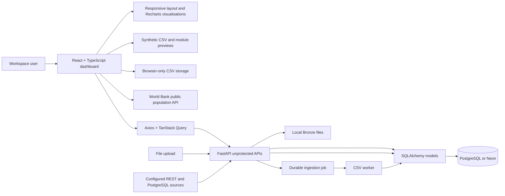
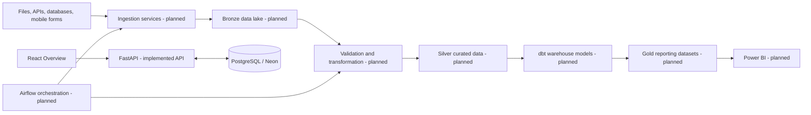

# System architecture

## Implemented now

The browser app is a client-side React dashboard. Overview defaults to the API snapshot. An optional illustrative programme CSV can be replaced by an uploaded aggregate CSV that persists only in the browser's local storage. A separate browser request fetches national population context from the World Bank; this is not programme data and may be unavailable offline. The demo identity is stored in the browser and is not authentication; sources and files are shared through the unprotected API. Other modules remain previews.

The backend includes FastAPI, SQLAlchemy and Alembic-managed models. Authentication and authorization are disabled; the API must not be exposed outside a trusted local environment. Synchronous CSV, XLSX, XLS and JSON imports preserve original bytes on local disk and record dataset metadata and success or failure in PostgreSQL. REST imports retain the response bytes; PostgreSQL imports retain an extracted JSON snapshot. External destinations come from server-managed configuration and PostgreSQL reads run in a read-only transaction. Participation rows remain in Bronze, not beneficiary tables. Aggregate imports update programmes by name. The Phase 4 Pandas pipeline reads Bronze files, writes validated Silver rows and quarantined rejects, produces local Gold summaries, and records quality and run metadata in PostgreSQL. The older CSV worker is separate. Distributed execution and managed object storage are not implemented.

## Intended evolution

The architecture below is a target, not a description of currently working services. Transformation, shared storage, orchestration, warehouse, and reporting components are planned.

## Frontend organization

- `frontend/src/components/`: reusable dashboard, navigation, KPI, charts, demo execution table, and module preview components.
- `frontend/src/data/`: seeded synthetic dashboard generator, navigation definitions, and focused tests.
- `frontend/src/services/`: Axios client and dashboard API mapping.
- `frontend/src/types/`: dashboard data contracts.

Future services should be introduced in their approved phases and documented only after implementation and testing.
