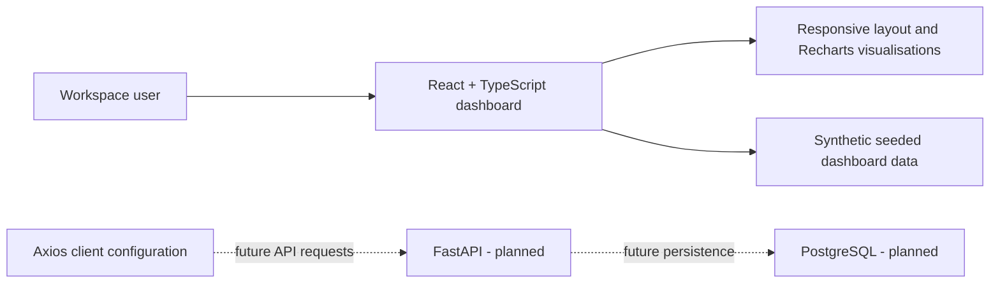
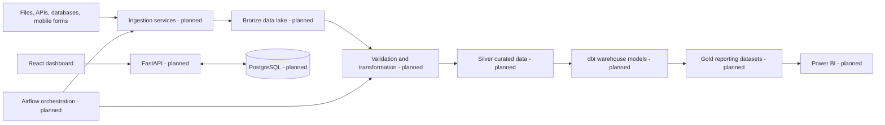

# System architecture

## Implemented now

The current browser app is a client-side React dashboard with navigable module design previews. Its data generator produces repeatable synthetic samples for a fixed seed and reference date; Axios and TanStack Query are configured as frontend integration foundations but are not used to retrieve dashboard values. Framer Motion animates dashboard metrics with reduced-motion support. There is no backend or persistence layer in this phase.

## Intended evolution

The architecture below is a target, not a description of currently working services.

## Frontend organization

- `frontend/src/components/`: reusable dashboard, navigation, KPI, charts, demo execution table, and module preview components.
- `frontend/src/data/`: seeded synthetic dashboard generator, navigation definitions, and focused tests.
- `frontend/src/services/`: shared Axios configuration for later API work.
- `frontend/src/types/`: dashboard data contracts.

Future services should be introduced in their approved phases and documented only after implementation and testing.
